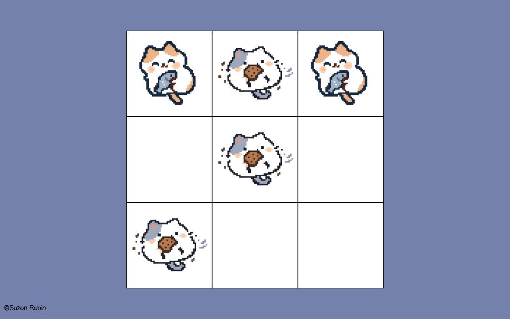
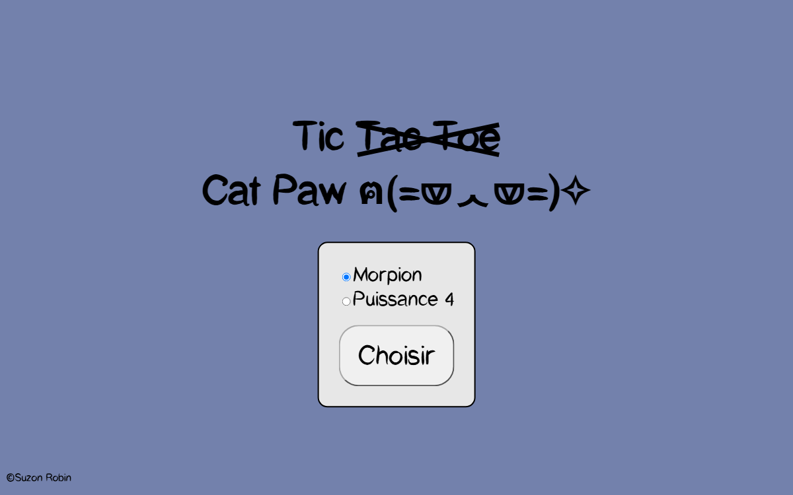
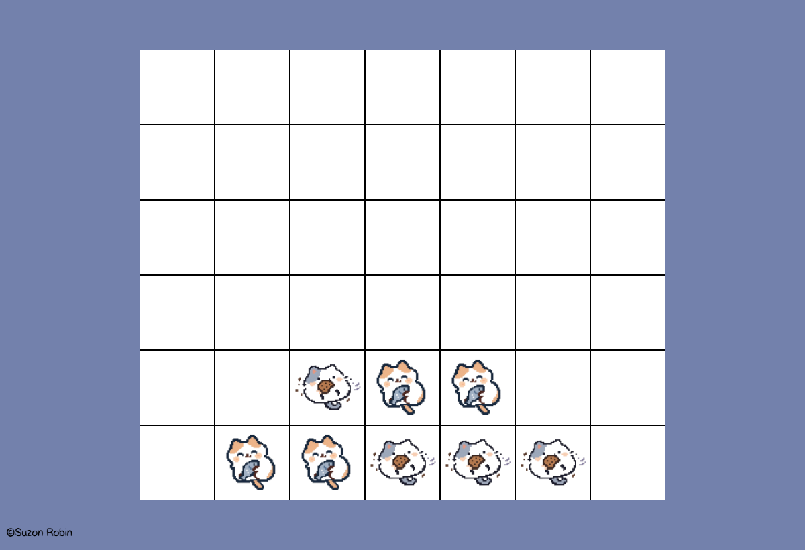

# Tic Tac Toe Cat Paw

Two classic games in one page, with cats: **tic-tac-toe** and **connect four**.
Cookie-Cat against Fish-Cat, with a friend or against the computer.

**[▶ Play in your browser](https://suzonz.github.io/Tic-Tac-Toe/)**



| Menu | Connect four |
|---|---|
|  |  |

The game is in French.

## Play

Play it online with the link above, or open `index.html` in a browser (Chrome, Firefox, Edge…). Nothing to install.

1. Choose a game: **Morpion** (tic-tac-toe) or **Puissance 4** (connect four).
2. Choose a mode: **Joueur Vs Joueur** (two players on the same screen) or **Joueur Vs Ordinateur** (against the computer).
3. Read the rule, then click **Jouer**.

After a game, **Rejouer** starts a new one and **Menu** goes back to the start screen.

## Rules

- **Tic-tac-toe**: click a square to put your cat in it. The first to line up 3 cats (row, column or diagonal) wins.
  A full grid with no winner is a draw.
- **Connect four**: click a column, and your cat falls to the lowest free square.
  The first to line up 4 cats (row, column or diagonal) wins.

Cookie-Cat always starts. Each cat has its own meow.

## Project structure

```
index.html            page: start screen, rules, game board, buttons
assets/
  css/style.css       layout, buttons, grids
  js/main.js          both games: menus, grids, turns, falling tokens, win checks, computer player
  images/             Cookie-Cat and Fish-Cat
  audio/              one meow per cat
  fonts/              Catcafe font
screenshots/          images used in this README
```

The grids are built in JavaScript. The computer player picks a random free square (tic-tac-toe) or a random free column (connect four).

## Credits

- Game and code: **Suzonz**

## License

The code is released under the [MIT License](LICENSE).
